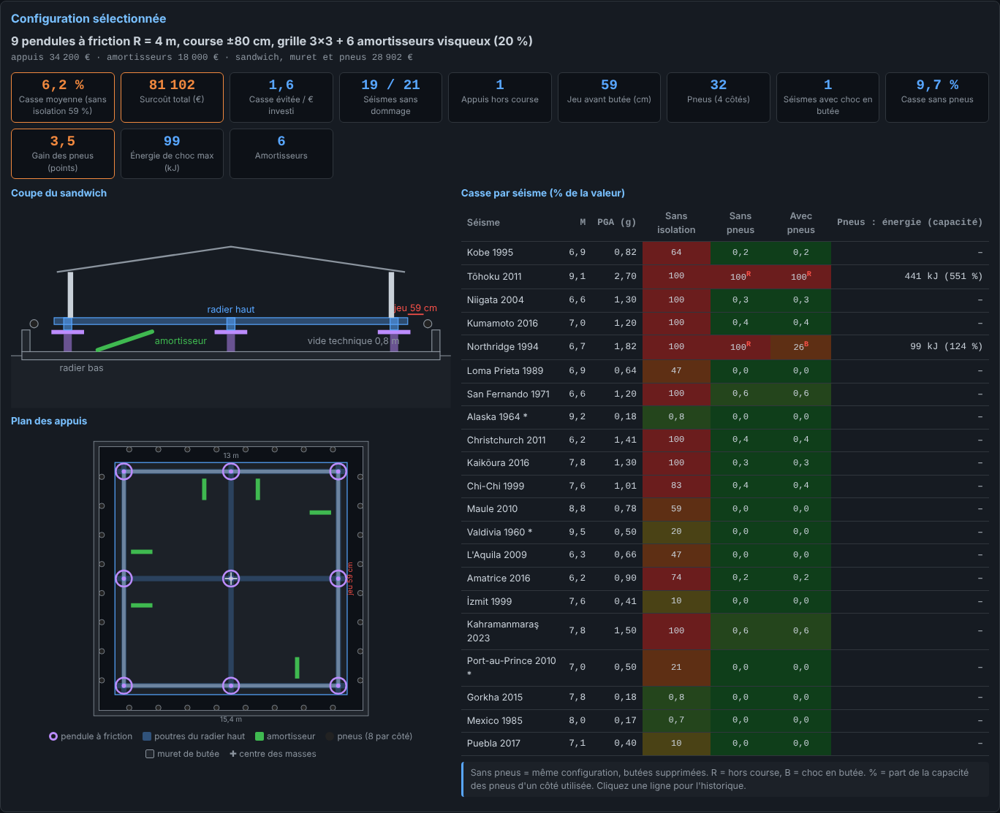
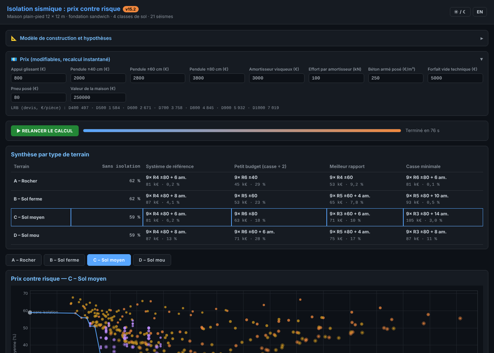

<!--
  Nom      : LISEZMOI.md
  Objet    : Présentation du simulateur d'isolation sismique (dépôt GitHub)
  Auteur   : Eric PERRET — assistance Claude (Anthropic)
  Date     : 2026-10-17
  Version  : 15.2
  Licence  : CC BY-NC 4.0 — usage commercial interdit sans accord écrit de l'auteur
-->

# Simulateur d'isolation sismique — maison de plain-pied

🇬🇧 [English version: README.md](README.md)

▶️ **[Lancer le simulateur](https://ericperret.github.io/Sismic/simulateur_sismique.html)** — le calcul démarre seul au chargement.

Outil autonome (un seul fichier HTML) d'aide au choix de l'isolation sismique d'une maison de plain-pied de 12 × 12 m.
Il compare des centaines de configurations d'appuis sur 21 séismes de référence et 4 classes de sol, trace la **courbe prix / risque** et donne surtout, pour la configuration choisie, le **plan de pose des dispositifs** : position des pendules à friction ou des LRB, des amortisseurs, des butées et des pneus, avec la coupe du sandwich et le jeu à respecter.

## Utilisation

1. Ouvrir le lien ci-dessus, ou télécharger `simulateur_sismique.html` et l'ouvrir dans un navigateur récent (Firefox, Chrome, Edge).
2. Le calcul démarre seul (≈ 1 min 30, calcul parallèle sur 4 cœurs).

Aucune installation, aucune librairie, aucune connexion requise.
Les prix sont modifiables dans l'en-tête : la courbe se met à jour instantanément, sans relancer le calcul.

## Fonctions

| Fonction | Description |
|---|---|
| Synthèse par terrain | Rocher, sol ferme, sol moyen, sol mou : sans isolation, système de référence, petit budget, meilleur rapport, casse minimale |
| Nuage prix / risque | Chaque point est une configuration ; la ligne relie les meilleurs compromis ; un clic sur un point affiche le détail |
| **Plan de pose** | Pour la configuration sélectionnée : plan coté des appuis (pendules ou LRB), des amortisseurs, du muret de butée et des pneus, centre des masses ; coupe du sandwich avec le jeu avant butée ; coût détaillé |
| Casse par séisme | Sans isolation, sans pneus, avec pneus, énergie absorbée par les butées |
| Historique d'un séisme | Accélération de la maison (enveloppes et seuils de casse), déplacement des appuis (jeu, course), cause de la casse |
| Prix modifiables | Accessoires, béton, pneus, valeur de la maison : courbe recalculée sans relancer la simulation |
| Interface | Français / anglais (langue du navigateur détectée, bouton FR / EN), thèmes clair et sombre |

## Modèle de construction

| Élément | Description |
|---|---|
| Maison | plain-pied 12 × 12 m, parpaing chaîné, tôle sur charpente |
| Radier bas | béton armé 30 cm coulé au sol, élargi pour porter le muret de butée |
| Vide technique | 0,8 m, ventilé, appuis et amortisseurs |
| Appuis | pendules à friction (R 3 à 6 m, course 40 / 60 / 80 cm) ou LRB D400 à D1000, seuls ou avec appuis glissants |
| Amortisseurs | visqueux, 0 à 30 % d'amortissement, nombre selon l'effort |
| Radier haut | nervuré : 6 poutres BA 30 × 50 + poutrelles-hourdis 20+5 (≈ 80 t) |
| Butées | muret BA périphérique + pneus de poids lourd posés à plat |

**Système de référence** : 9 pendules à friction R = 4 m, course ±80 cm, grille 3 × 3, amortisseurs 20 % (30 % en sol mou), butées en pneus.

## Méthode

- Intégration temporelle Newmark-β (accélération moyenne) avec Newton-Raphson exact par branche.
- Appuis : modèle bilinéaire hystérétique à écrouissage cinématique (LRB, pendules, glissants).
- Butées : contact non linéaire de Hunt-Crossley.
- Séismes : accélérogrammes artificiels compatibles avec le spectre Eurocode 8 type 1 de chaque sol, calés sur le PGA enregistré.
- Torsion : excentricité accidentelle de 5 % (EC8), contrôle à l'appui d'angle.
- Casse : murs (cisaillement et hors plan), contenus (seuils d'accélération type HAZUS), rupture si les butées sont écrasées.
- Risque : casse moyenne sur les 21 séismes, en % de la valeur de la maison.

## Séismes de référence

Kobe 1995, Tōhoku 2011, Niigata 2004, Kumamoto 2016, Northridge 1994, Loma Prieta 1989, San Fernando 1971, Alaska 1964, Christchurch 2011, Kaikōura 2016, Chi-Chi 1999, Maule 2010, Valdivia 1960, L'Aquila 2009, Amatrice 2016, İzmit 1999, Kahramanmaraş 2023, Port-au-Prince 2010, Gorkha 2015, Mexico 1985, Puebla 2017.

Magnitude et PGA sont affichés pour chacun. Tōhoku (2,7 g) est volontairement conservé comme pire cas.

## Limites

Outil d'aide à la décision et de pré-dimensionnement. Il ne remplace pas une étude par un bureau d'études structure ni la conformité aux règles parasismiques applicables.
Les prix des accessoires (pendules, amortisseurs, béton, pneus) sont des estimations à adapter aux réalités locales ; les prix LRB proviennent d'un devis.
La capacité d'absorption des pneus usagés est dispersée : un essai de compression sur un pneu est recommandé.

## Historique

| Version | Évolution |
|---|---|
| 11 | LRB bilinéaire, TMD liquide et pendulaire, 3 DDL |
| 12 | 4 DDL, Newton-Raphson, critères EN 15129 / EC8, interface bilingue |
| 13 | Balayage automatique des appuis, verdicts piscine / big-bag |
| 14 | Fondation sandwich, pendules à friction, amortisseurs, courbe prix / risque |
| 15 | Système de référence, radier nervuré, butées en pneus, casse sans / avec pneus |
| 15.2 | Langue du navigateur détectée au chargement |

Le détail de chaque version figure dans le cartouche en tête de `simulateur_sismique.html`.

## Technique

HTML / CSS / JavaScript natif, fichier unique, sans dépendance externe. Calcul parallèle sur 4 Web Workers.

## Licence

[CC BY-NC 4.0](https://creativecommons.org/licenses/by-nc/4.0/deed.fr) — Attribution, pas d'utilisation commerciale.

- Utilisation, copie et modification libres à des fins **non commerciales**, avec **mention de l'auteur** (Eric PERRET).
- Toute **utilisation commerciale est interdite sans accord écrit** de l'auteur.

Voir le fichier [LICENSE](LICENSE).
