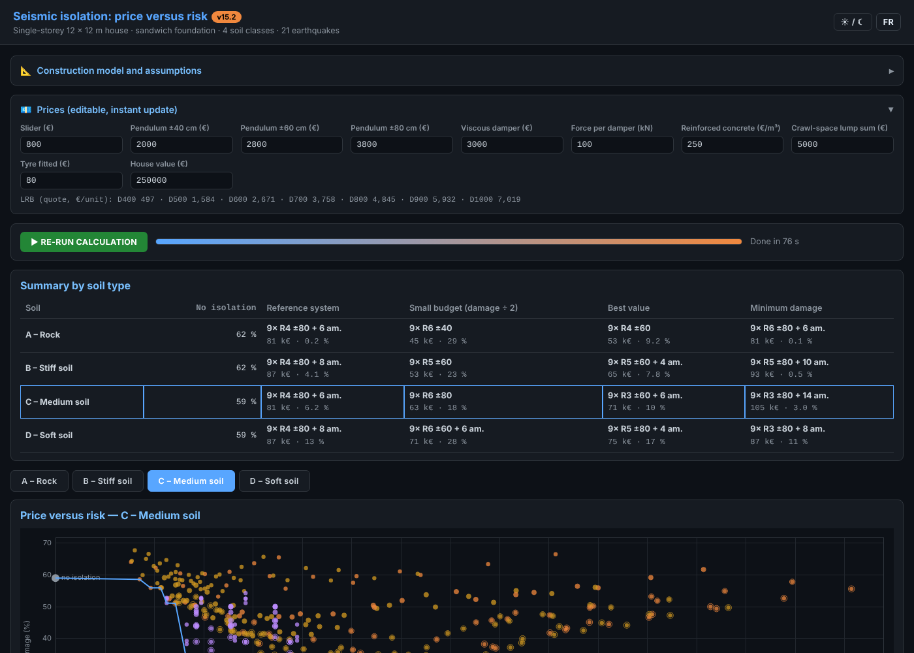

<!--
  Name     : README.md
  Purpose  : Overview of the seismic isolation simulator (GitHub repository)
  Author   : Eric PERRET — assisted by Claude (Anthropic)
  Date     : 2026-10-17
  Version  : 15.2
  License  : CC BY-NC 4.0 — commercial use forbidden without the author's written consent
-->

# Seismic isolation simulator — single-storey house

🇫🇷 [Version française : LISEZMOI.md](LISEZMOI.md)

▶️ **[Launch the simulator](https://ericperret.github.io/Sismic/simulateur_sismique.html)** — the computation starts by itself on load.

A standalone tool (one single HTML file) to help choose the seismic isolation of a 12 × 12 m single-storey house.
It compares hundreds of bearing configurations against 21 reference earthquakes and 4 soil classes, and plots the **price / risk curve** to support the choice.

## Usage

1. Open the link above, or download `simulateur_sismique.html` and open it in a recent browser (Firefox, Chrome, Edge).
2. The computation starts by itself (≈ 1 min 30, parallel computation on 4 cores).

No installation, no library, no network connection required.
Prices can be edited in the header: the curve updates instantly, without re-running the computation.

## Features

| Feature | Description |
|---|---|
| Summary by soil | Rock, stiff soil, medium soil, soft soil: no isolation, reference system, small budget, best value, minimum damage |
| Price / risk scatter | Each point is a configuration; the line joins the best trade-offs; clicking a point shows its details |
| Selected configuration | Detailed cost, section and plan of the sandwich foundation, bearings, dampers, end stops |
| Damage per earthquake | No isolation, without tyres, with tyres, energy absorbed by the end stops |
| Earthquake time history | House acceleration (envelopes and damage thresholds), bearing displacement (gap, stroke), cause of damage |
| Editable prices | Accessories, concrete, tyres, house value: curve recomputed without re-running the simulation |
| Interface | French / English (browser language detected, FR / EN button), light and dark themes |

## Construction model

| Element | Description |
|---|---|
| House | single storey 12 × 12 m, tied concrete blockwork, metal sheet roof on timber frame |
| Lower raft | 30 cm reinforced concrete cast on the ground, widened to carry the stop wall |
| Crawl space | 0.8 m, ventilated, bearings and dampers |
| Bearings | friction pendulums (R 3 to 6 m, stroke 40 / 60 / 80 cm) or LRB D400 to D1000, alone or with sliders |
| Dampers | viscous, 0 to 30 % damping, number set by the force |
| Upper raft | ribbed: 6 RC beams 30 × 50 + beam-and-block floor 20+5 (≈ 80 t) |
| End stops | perimeter RC wall + truck tyres laid flat |

**Reference system**: 9 friction pendulums R = 4 m, stroke ±80 cm, 3 × 3 grid, 20 % dampers (30 % on soft soil), tyre end stops.

## Method

- Newmark-β time integration (average acceleration) with exact Newton-Raphson per branch.
- Bearings: bilinear hysteretic model with kinematic hardening (LRB, pendulums, sliders).
- End stops: Hunt-Crossley non-linear contact.
- Earthquakes: artificial accelerograms compatible with the Eurocode 8 type 1 spectrum of each soil, scaled to the recorded PGA.
- Torsion: 5 % accidental eccentricity (EC8), checked at the corner bearing.
- Damage: walls (shear and out-of-plane), contents (HAZUS-type acceleration thresholds), failure if the end stops are crushed.
- Risk: mean damage over the 21 earthquakes, as a % of the house value.

## Reference earthquakes

Kobe 1995, Tōhoku 2011, Niigata 2004, Kumamoto 2016, Northridge 1994, Loma Prieta 1989, San Fernando 1971, Alaska 1964, Christchurch 2011, Kaikōura 2016, Chi-Chi 1999, Maule 2010, Valdivia 1960, L'Aquila 2009, Amatrice 2016, İzmit 1999, Kahramanmaraş 2023, Port-au-Prince 2010, Gorkha 2015, Mexico City 1985, Puebla 2017.

Magnitude and PGA are shown for each. Tōhoku (2.7 g) is deliberately kept as the worst case.

## Limitations

Decision-support and preliminary design tool. It does not replace a study by a structural engineering office nor compliance with the applicable seismic regulations.
Accessory prices (pendulums, dampers, concrete, tyres) are estimates to be adapted to local conditions; LRB prices come from a quote.
The absorption capacity of used tyres is scattered: a compression test on one tyre is recommended.

## History

| Version | Change |
|---|---|
| 11 | Bilinear LRB, liquid and pendulum TMD, 3 DOF |
| 12 | 4 DOF, Newton-Raphson, EN 15129 / EC8 criteria, bilingual interface |
| 13 | Automatic bearing sweep, swimming-pool / big-bag verdicts |
| 14 | Sandwich foundation, friction pendulums, dampers, price / risk curve |
| 15 | Reference system, ribbed raft, tyre end stops, damage without / with tyres |
| 15.2 | Browser language detected on load |

The detail of each version is in the header block of `simulateur_sismique.html`.

## Technology

Native HTML / CSS / JavaScript, single file, no external dependency. Parallel computation on 4 Web Workers.

## License

[CC BY-NC 4.0](https://creativecommons.org/licenses/by-nc/4.0/) — Attribution, NonCommercial.

- Free use, copy and modification for **non-commercial** purposes, with **credit to the author** (Eric PERRET).
- Any **commercial use is forbidden without written consent** from the author.

See the [LICENSE](LICENSE) file.
